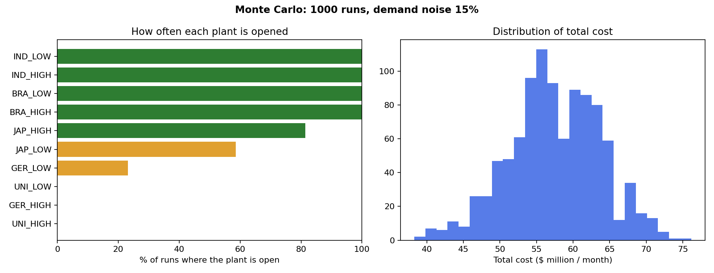

# Supply Chain Network Design with Python (MILP)

Which factories should a company open, and how much should each ship to each market, to meet demand at the lowest total monthly cost?

This project models a **facility location / network design** problem as a **Mixed-Integer Linear Program (MILP)**, solves it in Python, and runs what-if scenarios (e.g. shipping costs x5).

## 1. Problem

- 5 markets: United States, Brazil, Germany, India, Japan, each with a monthly demand (units).
- 10 candidate plants: each country can host a **Low** (500k units/month) or **High** (1.5M units/month) capacity plant.
- Each plant has a **fixed cost** ($/month, paid only if the plant is open) and a **variable production cost** ($/unit).
- Shipping is priced per container (1 container = 1,000 units) and depends on origin and destination.

**Decide:** which plants to open, and how many units each open plant ships to each market.

## 2. Mathematical model

**Sets and parameters**

| Symbol | Meaning |
|---|---|
| $p \in P$, $m \in M$ | plants, markets |
| $F_p$ | fixed cost of plant $p$ ($/month) |
| $V_p$ | variable production cost ($/unit) |
| $\mathrm{Cap}_p$ | capacity (units/month) |
| $S_{pm}$ | freight from $p$ to $m$ ($/container) |
| $D_m$ | demand of market $m$ (units/month) |
| $U$ | units per container (1,000) |

**Decision variables**

- $y_p \in \{0,1\}$: 1 if plant $p$ is opened
- $x_{pm} \ge 0$: units shipped from $p$ to $m$

**Objective** (minimize total monthly cost)

$$
\min \; \sum_{p} F_p\, y_p \;+\; \sum_{p}\sum_{m} \Big(V_p + \frac{S_{pm}}{U}\Big)\, x_{pm}
$$

**Constraints**

$$
\sum_{p} x_{pm} \ge D_m \quad \forall m \qquad \text{(meet demand)}
$$

$$
\sum_{m} x_{pm} \le \mathrm{Cap}_p \, y_p \quad \forall p \qquad \text{(capacity, and ship only if open)}
$$

The second constraint links the two kinds of variables: if $y_p = 0$ the right-hand side is 0, so a closed plant cannot ship anything.

The binary $y_p$ is what makes this a MILP rather than a plain LP.

### Tiny worked example

Demand 400,000 units. Plant A: fixed 100,000, production 10, freight 1/unit. Plant B: fixed 300,000, production 8, freight 2/unit.

- A only: 100,000 + 400,000 x 11 = **4.5M**
- B only: 300,000 + 400,000 x 10 = **4.3M** (cheaper despite the higher fixed cost)

## 3. Pseudo code

```text
load plants, markets, freight
UNITS_PER_CONTAINER = 1000

model = Problem(MINIMIZE)
y[p]    = BinaryVar          for each plant
x[p][m] = ContinuousVar >= 0 for each plant, market

model += SUM(fixed[p] * y[p])
       + SUM((var_cost[p] + freight[p][m] / UNITS_PER_CONTAINER) * x[p][m])

for m in markets: model += SUM_p(x[p][m]) >= demand[m]
for p in plants:  model += SUM_m(x[p][m]) <= capacity[p] * y[p]

solve(model)
read y -> open plants, x -> flows, objective -> total cost

for scenario in [base, freight_x5, ...]:
    change parameters, re-solve, compare with base
```

## 4. Repository structure

```text
data/        plants.csv, markets.csv, freight.csv (+ the same data in one .xlsx, with formulas)
src/         network_design_pulp.py (PuLP 3.x), monte_carlo.py
results/     scenarios.csv, flows_<scenario>.csv, Monte Carlo outputs (mc_*.csv, mc_summary.png)
```

## 5. How to run

```bash
pip install -r requirements.txt
python src/network_design_pulp.py      # solves base + scenarios, writes results/   (needs PuLP 3.x)
```

## 6. Results (synthetic data)

| Scenario | Total cost ($/month) | vs base | Open plants |
|---|---:|---:|---|
| Base | 57,445,000 | - | BRA_LOW, BRA_HIGH, IND_LOW, IND_HIGH, JAP_HIGH |
| Freight x5 | 71,450,000 | +24.4% | UNI_HIGH, BRA_LOW, BRA_HIGH, IND_LOW, IND_HIGH |
| IND_HIGH fixed cost x2 | 58,745,000 | +2.3% | same as base |

Optimal flows in the base case (units/month):

| Plant | United States | Brazil | Germany | India | Japan |
|---|---:|---:|---:|---:|---:|
| BRA_LOW | 500,000 | 0 | 0 | 0 | 0 |
| BRA_HIGH | 700,000 | 800,000 | 0 | 0 | 0 |
| IND_LOW | 200,000 | 0 | 0 | 300,000 | 0 |
| IND_HIGH | 0 | 0 | 600,000 | 900,000 | 0 |
| JAP_HIGH | 900,000 | 0 | 0 | 0 | 500,000 |

**Reading the results**

- Base case: production is concentrated in low-cost countries (Brazil, India) plus one High plant in Japan, because production savings outweigh freight.
- Freight x5: the Japan plant is dropped and a High plant opens in the United States. Shipping is now expensive enough that producing near the largest market pays off.
- Doubling IND_HIGH's fixed cost raises cost by only 2.3% and does not change the network: the plant is still the cheapest way to serve India and Germany.

## 7. Monte Carlo: how robust is the network?

Demand is never known exactly, so I re-solved the model 1,000 times, each time multiplying every market's demand by a random factor drawn from a normal distribution (mean 1, standard deviation 15%), and recorded which plants were opened.

| Plant | Open in % of runs |
|---|---:|
| BRA_LOW, BRA_HIGH, IND_LOW, IND_HIGH | 100% |
| JAP_HIGH | 81.4% |
| JAP_LOW | 58.6% |
| GER_LOW | 23.2% |
| UNI_LOW | 0.1% |
| UNI_HIGH, GER_HIGH | 0% |

Total monthly cost: mean $57.5M, 5th to 95th percentile $47.0M to $67.9M.



**Reading it:** the four plants in Brazil and India are open in every single run, so that part of the decision is robust. Japan's large plant is open most of the time. Whether to add a small plant in Japan or Germany depends on how demand turns out. Re-running with another random seed moves these percentages by a few points at most, so 1,000 runs is enough for a stable picture.

```bash
python src/monte_carlo.py 1000 0.15 42   # runs, demand noise, seed
```

### PuLP versus Monte Carlo

They are not rivals. PuLP solves one planning problem; Monte Carlo re-uses that solver many times with random inputs to show how far the answer can be trusted.

| | PuLP (one solve) | Monte Carlo (1,000 solves) |
|---|---|---|
| What it is | Library that builds the model and calls a solver (CBC) | Simulation that re-runs the model with random demand |
| Question it answers | With this demand, what is the cheapest network? | If demand moves, which decisions still hold? |
| Demand used | One fixed set | 1,000 random sets (mean 1, sd 15%) |
| Result | $57,445,000 per month, 5 plants open | Mean $57.5M (P5 $47.0M to P95 $67.9M) and % of runs each plant is open |
| Certainty | Exact for the assumed demand, silent about risk | Shows solid decisions (Brazil and India: 100%) and demand-dependent ones (JAP_LOW 58.6%, GER_LOW 23.2%) |
| Use it when | Quick answer, named scenario (freight x5) | Real money at stake, uncertain demand |

## 8. Possible extensions

- Integer container flows and capacity per container.
- A Streamlit or Power BI dashboard on top of `results/`.
